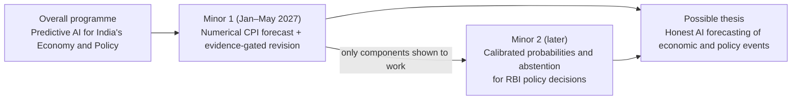
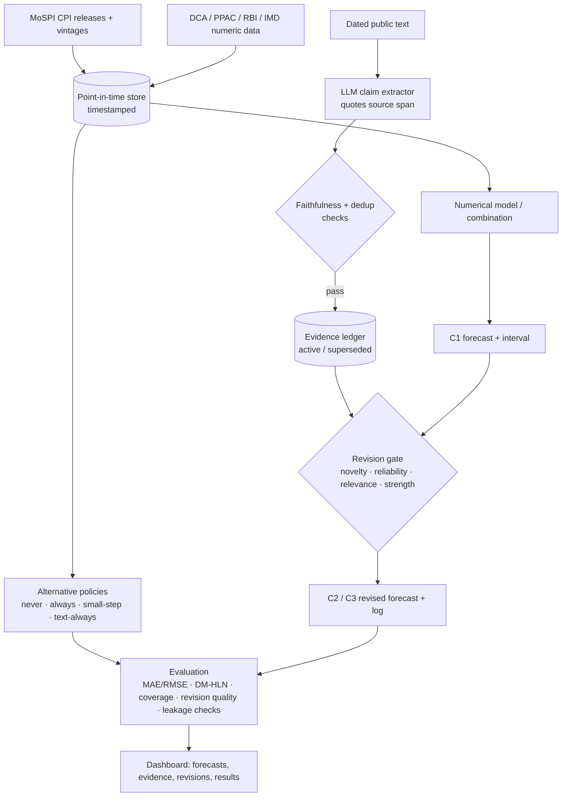
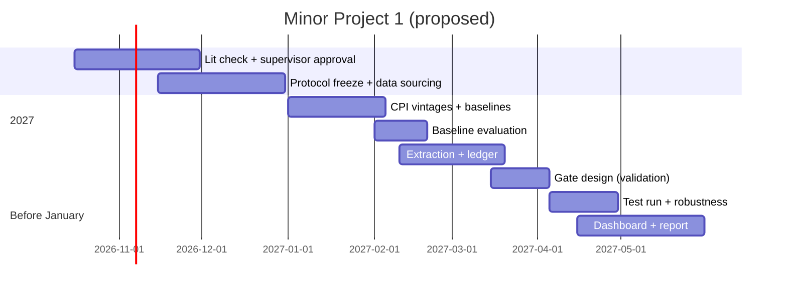

# Status legend

Every important statement in this report is tagged with one of these labels.

| Tag | Meaning |
|---|---|
| **[Verified]** | Directly supported by sources inspected for this report (full or key sections), or by code present in the repository |
| **[Reported]** | Stated in existing project notes, or in sources read only at abstract/search level. Not independently re-checked for this report |
| **[Proposed]** | A planned design or future feature. Nothing is implemented |
| **[Hypothesis]** | An outcome that must be tested experimentally |
| **[Unresolved]** | Needs more evidence or a supervisor decision |

**Reading levels for papers:** **F** = full text read · **K** = key sections of the full text read · **P** = partial (abstract plus introduction) · **A** = abstract or search-level only.

## Sources inspected for this report

| File | Status |
|---|---|
| `research/forecast/FINAL_TABLE.md` | Inspected |
| `research/forecast/VERIFICATION.md` | Inspected |
| `research/forecast/LEVEL2_READINGS.md` | Inspected |
| `research/forecast/CLOSEST_METHODS.md` | Inspected (uncommitted) |
| `research/forecast/TARGET_PROTOCOL.md` | Inspected (uncommitted) |
| `research/forecast/paper/REVIEW_PAPER_DRAFT.md` (v0.5) | Inspected |
| `PROGRESS.md`, `README.md`, `PROJECT_PLAN.md`, `RESEARCH_REPORT.md` | Inspected |
| `docs/ARCHITECTURE.md`, `firestore.rules`, `database.rules.json`, `pubspec.yaml`, `lib/**`, `test/**` | Inspected |
| `SCIENCE_DIRECTION.md`, `RESEARCH_OUTLINE.md` | **Not found** in the repository |

**Contradictions found:**
1. `README.md` and `docs/ARCHITECTURE.md` still describe the earlier plan (Yes/No question benchmark, `MILESTONE_1.md` backend). `PROJECT_PLAN.md` (15 Oct 2026) and the research files describe the current CPI-revision plan. This report follows the newer files and flags the older ones as outdated.
2. `RESEARCH_REPORT.md` says "37 papers reviewed; 13 read in full". Later rounds raised the number read fully or in key sections to about 23. This report uses the newer count.

---

# 1. Executive summary

**What the programme is.** *Predictive AI for India's Economy and Government Policy* (provisional title, pending supervisor approval) studies AI systems that forecast Indian economic and policy outcomes from historical data and dated public evidence. The aim is for these systems to state their uncertainty, track new evidence, explain why a forecast changed, and be scored honestly against what actually happened.

**Minor Project 1 (Jan–May 2027, proposed).** *Reflica India: Evidence-Aware Economic Forecasting and Forecast Revision.*
- A **numerical model** forecasts India's all-India CPI-Combined (CPI-C) headline inflation, year-on-year, for the next month.
- A **language model** extracts dated, source-linked claims from public text.
- A **pre-specified revision gate** decides whether the claims justify revising the numerical forecast.
- The study tests whether this gate does better than four alternatives: never updating, always updating, updating in small steps, and using text without a gate. The test is a chronological, leakage-controlled backtest.

**Status.** No forecasting code, data pipeline or experiment exists yet **[Verified: no Python code in the repository]**. The Flutter/Firebase app is a sign-in, homepage and dashboard shell **[Verified]**.

**What the literature already covers [Verified/Reported].**
- Strong Indian CPI model combinations (Mohan et al., 2025) [F].
- Text and news used as forecasting features (Kalamara et al.; Pratap et al., 2021; Das & Das, 2024).
- Automatic nowcast revision driven by numeric "news" (Bańbura & Modugno; Bańbura, Giannone & Reichlin) [F].
- Claim-level evidence ledgers inside LLM forecasting agents (Forecast-Dojo) [K].
- Hourly LLM-agent nowcasts of US CPI that change as news arrives (LiveMacroEval) [A].

**Candidate gap [Unresolved, provisional v6].** Among the papers checked, none tested whether an *explicit, pre-registered, scored* gate over dated text claims, applied to a *separate numerical* CPI forecast, beats never-update, always-update and small-step policies at equal horizons. This is **not yet claimed as novel**. LiveMacroEval has not been read in full, and the search was not exhaustive.

**Next decisions.**
- Supervisor approval of scope and title.
- Freezing the target protocol (CPI release dates, the 2024 = 100 linking factor, data vintages).
- Building the numerical baseline before any language-model component.

---

# 2. Overall research programme

## 2.1 Vision in plain language

India's economy produces many numbers every month: inflation, food and fuel prices, industrial output. Policy bodies such as the Reserve Bank of India (RBI) make decisions that change those numbers.

People who must plan ahead want three things from a forecast:
1. **What is likely to happen.**
2. **How sure** the forecaster is.
3. **Why** the forecast changed since last time.

Many AI forecasting tools give a number, or a confident paragraph, without (2) or (3). They are also rarely scored honestly against outcomes they could not have seen.

The **long-term objective [Proposed]** is AI forecasting systems that:
- use only information that was public at the time of the forecast;
- produce a forecast with an uncertainty range or probability;
- record which pieces of evidence were used, from which sources and dates;
- change a forecast only for documented reasons, and log each change;
- are evaluated against real outcomes and strong simple baselines;
- say "the evidence is not strong enough" when that is the honest answer (Minor Project 2).

## 2.2 How the stages fit together



| Stage | Question | Output type |
|---|---|---|
| Minor 1 | When should new textual evidence change a numerical forecast? | A number plus an interval (CPI inflation) |
| Minor 2 | Can policy-decision probabilities be calibrated, and can the system abstain sensibly? | Probabilities over outcomes (cut / hold / hike), or abstain |
| Thesis (future) | Can the validated parts be combined and evaluated live? | Integrated, live-evaluated forecasting |

**Status:** the overall direction and all titles are **[Unresolved]** until the supervisor approves them. It must also be decided whether this replaces or extends the title on record ("AI-Powered Research Knowledge Graph and Change Impact Analysis System").

---

# 3. Minor Project 1 proposal

## 3.1 Title, abstract and keywords

**Provisional title:** *Reflica India: Evidence-Aware Economic Forecasting and Forecast Revision.*

**Abstract (proposal; no results).** Inflation forecasts are revised as new information arrives, but deciding *when* a piece of news should change a forecast is rarely made explicit or tested.

This project proposes and evaluates an evidence-aware revision policy for forecasting India's monthly all-India CPI-Combined headline inflation (year-on-year), one month ahead.
- A numerical forecasting model, selected from statistical baselines and model combinations, produces the forecast and a prediction interval.
- A language model extracts structured, dated, source-linked claims from public text, and only performs extraction.
- A pre-specified gate scores the claims on novelty, source reliability, CPI relevance and strength, and decides whether to revise the forecast and by how much. Every decision is logged.

The gated policy will be compared with never-update, always-update (numeric re-estimation), small-step and text-always policies. All policies use the same forecast checkpoints. The comparison uses a walk-forward, point-in-time backtest with gate thresholds frozen on validation data.

Evaluation will cover:
- MAE and RMSE, with Diebold–Mariano tests using a small-sample correction;
- prediction-interval coverage;
- revision diagnostics;
- lookahead-bias checks.

The project will report whether gated revision helps, makes no difference, or harms accuracy.

**Keywords:** CPI inflation; India; forecast revision; nowcasting; news; large language models; evidence provenance; lookahead bias; walk-forward evaluation.

**Central research question:** see §3.5.

## 3.2 Introduction and background

**What CPI inflation is.**
- The Consumer Price Index measures the cost of a fixed basket of goods and services bought by households.
- Year-on-year (y-o-y) CPI inflation is the percentage change in the index compared with the same month a year earlier.
- India's National Statistics Office (NSO, MoSPI) publishes all-India CPI for rural, urban and combined areas each month **[Verified: used as the target in Mohan et al. 2025 and Pratap & Sengupta 2019]**.
- A new series with base year 2024 = 100 is reported to start in 2026 **[Reported; Unresolved: exact launch month and linking factor]**.

**Why forecasting it matters.**
- The RBI's monetary policy targets headline CPI inflation.
- Inflation forecasts and the risks around them are central to forward-looking policy, as Mohan et al. (2025) note for inflation-targeting central banks **[Verified, F]**.

**Why it is hard.**
- Indian inflation is volatile and dominated by food. Three vegetables (tomato, onion, potato) carry only about 2.2% CPI weight but drive much of the volatility in headline inflation (Pratap et al., 2021) **[Verified, F]**.
- Even a deep-learning study found the 1-month horizon hard for India: neural networks improved on benchmarks at every horizon except one month ahead (Mahajan & Srinivasan) **[Reported, A]**.
- Simple models are hard to beat on short Indian samples:
  - SARIMA beat all ML models on a 6-month test (Pratap & Sengupta, 2019) **[Verified, F]**.
  - A univariate ANN and simple regressions led on 12 quarterly forecasts (Singh & Bhoi, 2022) **[Verified, F]**.

**Why news may help.** Prices of food and fuel move with weather, supply disruptions and policy announcements, which newspapers report before the CPI release.
- Pratap et al. (2021) found that news sentiment on tomato, onion and potato improved some food-inflation forecasts **[Verified, F]**.
- Kalamara et al. (2020/2022) found newspaper text improves UK GDP, CPI inflation and unemployment forecasts, especially in stress periods **[Verified, K]**.

**Why unfiltered text can hurt.** Text is noisy, repetitive, sometimes irrelevant, contradictory or false.
- Adding news slightly *worsened* some forecasts in India: vegetable y-o-y relative RMSE went from 0.77 to 0.79 with news (Pratap et al., 2021) **[Verified, F]**.
- In Das & Das (2024), text features worsened random forest RMSE from 1.654 to 1.900 **[Verified, F]**.
- Wang et al. (2024) found unfiltered news worse than no news: electricity RMSE 407.86 vs 336.41 **[Verified, F]**.
- News-driven LLM forecasters can be manipulated by injected articles (Lu & Zhang, 2026) **[Reported, A]**.

**Why not update after every item.** Research on forecast revision shows a mixed picture:
- Updating helps for trending series but not stable ones (O'Connor et al., 2000) **[Reported, A]**.
- Small judgmental adjustments often hurt accuracy, while larger, informed ones help (Fildes et al., 2009) **[Reported, A]**.
- The best human forecasters update often and in small steps (Atanasov et al., 2020) **[Reported, A]**.

The right revision policy is therefore an empirical question.

**Why separate the forecaster from the language model.**
- LLMs output numbers poorly in zero-shot forecasting: GPT-3.5 often emitted incomplete numbers (Fang et al., 2024) **[Verified, F]**.
- LLM agents were reported to be weakest on inflation and CPI among US indicators (LiveMacroEval) **[Reported, A]**.
- LLMs can "remember" outcomes in backtests (Gao, Jiang & Yan) **[Verified, F]**.

Keeping a numerical model as the forecaster, with the LLM limited to extraction, is therefore a reasonable design to *test* **[Hypothesis]**.

## 3.3 Motivation and practical significance

Possible uses **[Proposed]**:
- **Inflation monitoring.** Early, documented signals of food or fuel price pressure between official releases.
- **Economic research.** A reproducible record of which public evidence moved a forecast and whether the move was justified by the outcome.
- **Inflation-risk assessment.** Intervals and logged revisions help users see when uncertainty rises.
- **Research workflows and decision support.** An auditable evidence ledger for analysts.

**Limits on these claims.**
- The system is not intended to predict or influence government decisions.
- It is not an official forecast.
- Any usefulness depends on the evaluation results.

## 3.4 Problem statement

Let π_m be all-India CPI-C y-o-y inflation for month m, as first published by NSO.

At fixed forecast origins before the release of month m's CPI (checkpoints C1–C3, §6.1), the information set contains only data and documents published before the origin. A numerical model gives an initial forecast at C1. Between checkpoints, new public text appears.

**Problem:** decide, using a rule fixed in advance, whether this new text justifies revising the forecast at C2 and C3, and by how much, so that the final pre-release forecast is more accurate and better calibrated than alternative policies.

The solution must:
- avoid **lookahead bias and leakage**: no future data, no revised values unknown at the time, and no LLM memory of outcomes;
- keep **intervals calibrated**;
- be robust to **noisy, duplicated, contradictory or unreliable text**;
- be compared against **strong numerical baselines**, including model combinations of the kind used by the RBI, on the **same target, origins and test period**.

## 3.5 Research questions and hypotheses

**Primary RQ.** Can a pre-specified, evidence-scored revision policy over dated textual claims improve forecasts from a numerical CPI forecasting model, compared with alternative revision policies, under leakage-controlled, time-ordered evaluation?

**Secondary RQs.**
- **RQ2.** Does adding text *without* a gate (text-always) help or hurt, compared with numeric-only updating?
- **RQ3.** Which gate components matter (novelty, reliability, relevance, strength)? Tested by ablation.
- **RQ4.** Does gating change interval calibration and revision behaviour (number of revisions, share in the right direction, unnecessary revisions)?
- **RQ5.** Do results differ between months likely seen by the LLM in training and months after its training cutoff?

**Hypotheses [Hypothesis]. Each may be rejected.**
- **H1.** At C3, the gated policy has lower MAE than never-update and text-always.
- **H2.** The gated policy is not worse than always-update (numeric) in MAE, and makes fewer harmful revisions.
- **H3.** Text-always is not better than numeric always-update. This matches the mixed text results in Indian studies.
- **H4.** The gated policy's 80% and 95% intervals are closer to nominal coverage than text-always.
- **H0 (null).** There is no difference between the policies at conventional significance levels. This is a valid outcome to report.

## 3.6 Objectives

| Type | Objective | How it is checked |
|---|---|---|
| Scientific | Test H1–H4 on a held-out period with frozen settings | DM–HLN tests and effect sizes reported, whatever the sign |
| Scientific | Measure each gate factor's contribution | Ablation table |
| Methodological | Freeze a written target and leakage protocol (`TARGET_PROTOCOL.md`) | Protocol version tagged before any test run |
| Methodological | Specify five revision policies precisely enough to reproduce | Written definitions plus code with fixed seeds |
| Methodological | Run a lookahead-bias check on the extraction model | LAP-style test results reported |
| System | Point-in-time dataset with timestamps and vintages | Data manifest with sources, timestamps and gaps |
| System | Claim extractor with quoted source spans and an evidence ledger | Faithfulness check rate on a hand-labelled sample |
| System | Revision engine that logs every decision | Log schema populated for every checkpoint |
| System | Dashboard view of forecasts, evidence and revisions | Working screen reading recorded data |
| Evaluation | Baseline results table (RW, SARIMA, combination, reduced Mohan-style suite) | Reproducible script and results file |
| Evaluation | Policy-comparison results, including null or negative findings | Results chapter |

## 3.7 Expected deliverables

This section lists deliverables, not results:
- protocol;
- dataset manifest;
- baseline and policy code;
- results tables;
- dashboard;
- report;
- possibly a paper draft, if the results justify it.

---

# 4. Literature review and comparison

## 4.1 Study-by-study analysis

**1. Mohan, Hasan, Roy, Sarkar & John (2025)**, *Predicting CPI inflation in India: Combining forecasts from a "suite" of statistical and machine learning models*, RBI Bulletin, 25 Jun. **[F: article text pasted by user; charts and equations missing]**
- **Research question:** do performance-weighted combinations of statistical, ML and DL models improve forecasts of India's headline and core CPI inflation?
- **Target and horizon:** seasonally adjusted annualised rate (SAAR) of CPI headline and core, 1–12 months ahead.
- **Data:** CPI Jan 2012–Jul 2024; crude (PPAC), INR–USD, real GDP and output gap (HP filter, Denton–Cholette disaggregation), repo rate.
- **Method:** 216 models (108 specifications × 36- and 96-month rolling windows), weighted by recent 12-month RMSE; split-normal density.
- **Evaluation:** pseudo-out-of-sample; DM tests with the Harvey–Leybourne–Newbold correction; Wilcoxon signed-rank tests.
- **Findings:**
  - The combination's average RMSE across horizons is about 70% below the random walk.
  - It beats more than 75% of individual models.
  - It is never significantly worse than a simple average, and significantly better in 12 of 16 cases (headline, 3-year window).
- **Limitations for us:**
  - No text and no revision logic.
  - The SAAR target is **not comparable** with y-o-y.
  - Equations and RMSE levels were not visible in our copy.
  - Pseudo-real-time only; the HP output gap has end-of-sample issues.

**2. Zhao, Zhang, Ye, Cao, Xie & Chava (2026)**, *Can LLMs Take the Pulse of the Economy? A Real-Time Evaluation of LLM Nowcasts on Macroeconomic Indicators* (LiveMacroEval), arXiv:2608.30110. **[A: arXiv listing, project site and secondary summaries only]**
- **Research question:** can web-search LLM agents nowcast US macro indicators live?
- **Target:** 16 US indicators including CPI. Hourly nowcasts during the window before each release.
- **Method:** GPT-5, Claude Sonnet 4.5 and Qwen3 agents with web search.
- **Evaluation:** a six-month live test. The LiveMacro Score weights indicators by S&P-futures reaction and compares against the Bloomberg consensus. A LiveBetting Score is also reported.
- **Reported findings:** GPT-5 is roughly equal to the consensus overall; the agents are weaker on inflation and CPI. Revisions are linked to events such as an EIA report and FOMC minutes.
- **Limitations for us:** **unknown until the full text is read**, in particular whether it uses an explicit update rule or compares update policies. It covers the US, not India, and the LLM is the forecaster.

**3. Ye, Wang, Ahmed, Zhang, He, Lin, Yin, Peng, Galarnyk, Chava & Zhang (2026)**, *Forecast-Dojo*, arXiv:2609.28876v1. **[K]**
- **Research question:** a replayable environment for benchmarking and training LLM forecasting agents.
- **Target:** 1,568 Polymarket events, binary or multiple-choice. Forecasts are made at successive dates.
- **Data:** 18.8M dated articles. Duplicates are removed by URL, title and MinHash, keeping the earliest version. Content is screened for leakage.
- **Method:** memory-free vs memory-on agents. The memory-on "belief notebook" holds an **append-only evidence ledger**: each claim has `date_observed`, a provenance or quality note, and an `active`/`superseded` status. The probability is to be kept "consistent with the active ledger".
- **Evaluation:** Brier score and accuracy against market prices.
- **Findings:**
  - Research tools help all 12 models.
  - Improvements are concentrated where more new dated evidence appears.
  - The notebook did not consistently improve quality (better for 6 models, worse for 6).
  - All models trail the market.
- **Limitations for us:**
  - The LLM decides how far to move the forecast; there is no scored, pre-registered gate.
  - The LLM is the forecaster.
  - Event questions only, not inflation.
  - No comparison of update policies.

**4. Kalamara, Turrell, Redl, Kapetanios & Kapadia (2020)**, *Making text count*, Bank of England SWP 865, later published in JAE 2022. **[K]**
- **Research question:** what is the best way to extract forecasting signals from newspaper text?
- **Target:** UK GDP, CPI inflation and unemployment.
- **Data:** The Guardian, Daily Mirror and Daily Mail (about 528k articles).
- **Method:** many text metrics. The best was term counts combined with supervised ML, with a rolling 36-month re-estimation.
- **Evaluation:** out-of-sample, with and without text.
- **Findings:** text improves forecasts, most of all in stressed periods.
- **Limitations for us:** text enters as aggregate features; no claim-level evidence or revision decision. The paper itself discusses real-time pitfalls of text.

**5. Thorsrud**, *Words are the New Numbers: A Newsy Coincident Index of the Business Cycle*, J. Business & Economic Statistics, pp. 393–409 (online Nov 2018). **[A: publisher abstract page]**
- **Method:** newspaper LDA topics in a time-varying factor model, with a **latent threshold** that switches topics on and off over time.
- **Reported:** near-perfect classification of business-cycle phases; nowcasts competitive with forecast combinations and expert judgement.
- **Limitations for us:**
  - Gating is learned and applies to topics, not individual claims.
  - The target is GDP and the business cycle.
  - Volume and issue number are not yet verified.

**6. Pratap, Ranjan, Kishore & Bhoi (2021)**, *Forecasting food inflation using news-based sentiment indicators*, RBI Occasional Papers 42(2). **[F]**
- **Target:** CPI-vegetables and food, month-on-month and y-o-y, h = 1–12.
- **Data:** 9 English dailies (not named), 2011–2021, collected via Meltwater with a keyword filter.
- **Method:** Loughran–McDonald lexicon with valence shifters; daily net sentiment; AR, SARIMA, VAR and MIDAS models.
- **Evaluation:** rolling out-of-sample on a 24-month test (Sep 2019–Aug 2021); RMSE relative to AR(1); **no significance tests**.
- **Findings:** mixed. Adding news sometimes helped and sometimes hurt.
- **Limitations for us:** an aggregate index; not the headline target; no release-date alignment; no uncertainty measures.

**7. Singh & Bhoi (2022)**, *Inflation forecasting in India: Are machine learning techniques useful?*, RBI Occasional Papers 43(2):46–88. **[F]**
- **Target:** quarterly headline CPI.
- **Method:** 12 one-quarter-ahead forecasts (2019Q1–2021Q4), expanding window, separate tuning window.
- **Findings:** a univariate ANN had the lowest RMSE (0.58); LSTM was worse.
- **Limitations for us:** revised data, a full-sample HP filter, no significance tests, quarterly only.

**8. Pratap & Sengupta (2019)**, *Macroeconomic forecasting in India: Does machine learning hold the key to better forecasts?*, ISI conference draft / RBI WP 04/2019. **[F, conference draft]**
- **Target:** monthly headline and component CPI.
- **Method:** single origin; 6-month test (Jul–Dec 2018).
- **Findings:** SARIMA had the lowest RMSE (0.24). Equal weights beat inverse-RMSE weights.
- **Limitations for us:** the test set was used to choose models and weights. No significance tests.

**9. Das & Das (2024)**, *Improvement in inflation forecasting: Ensembling text mining with macro data in machine learning models*, Int. J. Economics and Finance 16(6):92–101. **[F]**
- **Data:** India; Times of India headlines; a 166-word dictionary.
- **Method:** single 70/30 split.
- **Findings:** the best model with text (ANN, RMSE 1.560) is only about 6% better than the best model without text (RF, 1.654). Text hurt 2 of 5 models.
- **Limitations for us:** the dictionary was chosen on the full sample, including the test period. The CPI series and horizon are not stated. No significance tests.

**10. Wang, Feng, Qiu, Gu & Zhao (2024)**, *From News to Forecast*, NeurIPS. **[F]**
- **Domains:** electricity, exchange rates, traffic, bitcoin.
- **Method:** GPT-4 agents select news; a fine-tuned LLaMA-2 is the forecaster. "Reflection" rewrites the news-selection logic **during training only**.
- **Findings:** filtered news helps; unfiltered news hurts.
- **Limitations for us:** no decision on whether to revise an issued forecast; weak leakage control; no uncertainty measures.

**11. Gao, Jiang & Yan (2025/26)**, *Detecting lookahead bias in LLM forecasts*, arXiv:2512.23847v2. **[F]**
- **Method:** the Lookahead Propensity (LAP) test, using token probabilities from a prompt containing only the entity and date. The test checks whether a forecast's predictive power is amplified where the model shows high recall.
- **Findings:** strong memorisation before the model's training cutoff and none after it.
- **Relevance:** gives us a leakage check for our extraction step.

**12. Bańbura & Modugno (2010)**, ECB WP 1189 (JAE 2014), and **Bańbura, Giannone & Reichlin (2010)**, *Nowcasting*, ECB WP 1275 (Oxford Handbook 2011). **[F]**
- **Method:** dynamic factor models. A nowcast revision equals a weighted sum of each data release's **news**, i.e. its surprise relative to the model. This is "a weighted average of the news in the latest release".
- **Properties:** updating is "fully automatic"; an expected release changes nothing; revisions are attributed to individual series.
- **Targets:** GDP. BGR also covers HICP inflation, but it "is not our focus".
- **Limitations for us:** numeric inputs only; no gate; no text; no comparison of update policies. Modugno (2013) applies this to **US CPI** with daily and weekly energy prices **[P]**.

**Other relevant studies [A]:**
- ChatMacro (Alam et al., 2026): real-time LLM inflation forecasts were stale.
- EvolveCast (Yuan et al., 2025): LLMs under-react to new information.
- BLF (Murphy, 2026, v5) **[K]**: a belief state updated within one research loop.
- O'Connor et al. (2000), Goodwin (2000), Fildes et al. (2009), Atanasov et al. (2020): when revising helps.
- Nordhaus (1987), Isiklar et al. (2006), Coibion & Gorodnichenko (2015): revision efficiency.

## 4.2 Comparative table

| Study | Level | Target | Text use | What decides revision | Evaluation strength | Main gap for us |
|---|---|---|---|---|---|---|
| Mohan et al. 2025 | F | India CPI SAAR, 1–12 m | None | None (re-forecast at each origin) | Strong (DM–HLN, density) | No text; different target transform |
| LiveMacroEval 2026 | **A** | US CPI and others, pre-release | Web search by agent | LLM judgement (reported) | Live; vs consensus | Unknown until the full text is read |
| Forecast-Dojo 2026 | K | Events | Dated corpus; claim ledger | LLM judgement | Brier vs market | No scored gate; not numeric or inflation |
| Kalamara et al. | K | UK CPI, GDP, unemployment | Term counts + ML | None | Out-of-sample | Aggregate features |
| Thorsrud | A | GDP / business cycle | Topics, latent threshold | Learned topic gate | Out-of-sample | Topic-level; not inflation |
| Pratap et al. 2021 | F | India food/veg CPI | Daily lexicon index | None | Relative RMSE, no tests | Index; mixed gains |
| Singh & Bhoi 2022 | F | India CPI, quarterly | None | None | 12 forecasts, no tests | Quarterly; leakage risks |
| Pratap & Sengupta 2019 | F | India CPI, monthly | None | None | 6-month test | Test-set selection |
| Das & Das 2024 | F | India CPI | Word frequencies | None | 70/30 split, no tests | Look-ahead dictionary |
| Wang et al. 2024 | F | Non-macro | LLM-selected news | Training-time reflection | No tests | Not forecast-time revision |
| Gao et al. | F | US stocks / capex | — | — | Regression tests | Leakage tool only |
| Bańbura et al. | F | Euro-area GDP (+HICP) | None | Automatic news × weight | Pseudo real-time | Numeric; no gate or policies |

## 4.3 Synthesis: how the literature shapes our design

1. **Benchmark against strong combinations, on our own target.** Mohan et al. show that combinations are hard to beat. Their SAAR results cannot be compared directly with ours, so we re-implement a reduced version.
2. **Treat text as possibly harmful.** Indian and international results are mixed, so text must earn its place through gating, tested against text-always.
3. **Keep the numeric forecaster.** LLMs are weak at numeric and CPI forecasting [F/A], and they may remember outcomes [F].
4. **Learn from nowcasting.** Its *news × weight* revision is the natural always-update baseline and attribution template [F].
5. **Learn from evidence ledgers.** Forecast-Dojo's ledger fields (date observed, provenance note, superseded status) are a tested schema to adapt [K].
6. **Use strict evaluation.** Most Indian studies use very short tests without significance tests [F]. We use longer walk-forward tests with DM–HLN tests.

---

# 5. Research gap and candidate contributions

**Established prior work [Verified/Reported]:**
- Indian CPI forecasting with model combinations and ML (Mohan; Singh & Bhoi; Pratap & Sengupta) [F].
- Text as aggregate forecasting features, including for inflation (Kalamara [K]; Pratap 2021 [F]; Das & Das [F]).
- Automatic, attributed nowcast revision from numeric surprises (Bańbura et al. [F]; Modugno 2013 [P]).
- Learned, time-varying selection of news topics (Thorsrud [A]).
- LLM agents revising forecasts as dated news arrives, with claim-level ledgers (Forecast-Dojo [K]), including hourly US CPI nowcasts (LiveMacroEval [A]).

**Candidate research gap (v6) [Unresolved].** In the literature checked, no study tests whether an **explicit, pre-registered, scored revision gate over dated text claims**, applied to a **separate numerical** CPI forecast, beats **never-update, always-update and small-step** policies at equal horizons, with intervals and leakage controls.

**What remains unverified:**
- LiveMacroEval's full methods: whether it has an explicit update rule or compares policies.
- Thorsrud's full text.
- The literature search is not exhaustive. Areas not searched systematically include judgmental-adjustment automation, central-bank internal tools, and non-English work.

**Candidate contributions [Proposed]. Not claimed as novel.**

| Type | Contribution |
|---|---|
| Methodological | A documented, auditable revision gate (novelty, reliability, relevance, strength) operating on extracted claims, with frozen thresholds |
| Evaluation | A policy comparison (never / always / small-step / text-always / gated) at equal checkpoints, with DM–HLN tests and revision diagnostics, and null results reported |
| India application | A point-in-time Indian CPI dataset (data vintages, release timestamps, dated text), plus a reduced Mohan-style baseline adapted to y-o-y |

---

# 6. Methodology and experimental protocol

## 6.1 Stage A: define the target **[Proposed; from `TARGET_PROTOCOL.md` v0.1]**

- **Series:** all-India CPI-Combined, General Index (NSO/MoSPI).
- **Transformation:** π_m = 100 × (I_m / I_{m−12} − 1), computed from the index, with MoSPI's published rate as a cross-check.
- **Base change:** 2012 = 100 → 2024 = 100. Use only MoSPI's official linking or back-series **[Unresolved]**.
- **Forecast origins:** C1 (day after the release of month m−1), C2 (last day of month m), C3 (two days before the release of month m), each at 23:59 IST.
  - "One month ahead" means π_m forecast at C1.
  - C2 and C3 are revisions of the same target.
- **Scored forecast:** the forecast in force at C3. C1 and C2 are also reported.
- **Evaluation target:** first-published π_m (primary); final value (robustness).
- **SAAR vs y-o-y:**
  - SAAR (Mohan et al.) annualises the seasonally adjusted month-on-month change.
  - y-o-y compares with the same month a year earlier.
  - The two differ in level, noise and dynamics, so **RMSEs are not comparable**. Any comparison with Mohan et al. uses our own re-implementation on y-o-y.

## 6.2 Stage B: collect and timestamp data **[Proposed; availability Unresolved]**

| Source | Data | What must be checked |
|---|---|---|
| MoSPI / NSO | CPI indices; monthly press releases | Release rule (day, time, holidays); archive of releases; provisional → final revisions |
| Department of Consumer Affairs | Daily retail and wholesale prices of essentials | Historical archive, coverage, publication lag, terms of use |
| PPAC | Indian-basket crude; retail fuel prices | Historical series and dates |
| RBI / FBIL | INR–USD reference rate; repo rate; MPC statements | Archive access |
| IMD | Rainfall departure | Weekly archive dates |
| News (PIB, newspapers) | Articles for claim extraction | **Reliable historical first-publication timestamps**; licence for research use |

Rules:
- Use only items timestamped before the forecast origin.
- Use the data vintage that existed at the origin.
- Exclude any item whose timestamp is unreliable.

## 6.3 Stage C: numerical baseline **[Proposed]**

Models, all on the same target, origins and periods:
1. random walk / persistence;
2. AR and SARIMA;
3. ARX with crude, INR–USD and repo rate;
4. a small ML set (random forest, SVR);
5. equal-weight and inverse-RMSE combinations;
6. a **reduced Mohan-style suite** adapted to y-o-y.

This is an **adapted baseline, not a reproduction** of Mohan et al.

Also included:
- AR(1) and SARIMA as used by Pratap et al. 2021;
- a **text-as-features** baseline (term counts + ridge, dictionary frozen on training data only), following Kalamara et al. and Das & Das.

## 6.4 Stage D: extract claims **[Proposed]**

**Per-claim fields:**
- claim text and the **exact source quotation**;
- URL, outlet and first-publication timestamp;
- economic item (e.g., tomato, diesel);
- direction, and magnitude if stated;
- region and reference period;
- source type (official, wire, newspaper, other);
- extraction confidence;
- CPI relevance (item weight);
- links to supporting or contradicting claims.

**Handling rules:**
- **Unsupported extractions:** dropped if the quoted span is not in the source.
- **Duplicates:** URL, title and near-duplicate removal, keeping the earliest (as in Forecast-Dojo).
- **Contradictions:** kept, marked as conflicting, and lower the strength score.
- **Outdated claims:** marked `superseded` when newer evidence on the same item arrives.

The LLM never outputs the CPI forecast.

## 6.5 Stage E: evidence representation **[Proposed]**

An **append-only ledger**, which can also be viewed as a graph. It links:

```
claim → source (URL, timestamp)
claim → item → CPI subgroup (weight)
claim → checkpoint → forecast decision
```

- Each entry keeps provenance, status (active or superseded) and uncertainty.
- Links from items to CPI are **accounting relationships**: item weights in the basket.
- Any claimed *causal* effect, such as "rain raises tomato prices", is marked as a **hypothesised relationship**, not evidence of causation.

## 6.6 Stage F: revision gate **[Proposed; thresholds Unresolved]**

For each checkpoint, the new active claims are aggregated into a score using:
- **novelty:** not already reflected in data or earlier claims;
- **reliability:** source type and independent corroboration;
- **relevance:** CPI weight of the item and the time window;
- **strength:** stated size and agreement between sources;
- **uncertainty:** extraction confidence and conflicts.

The forecast is revised only if the score passes a threshold. The revision size is bounded. The functional form, weights, threshold and bound are chosen on **training and validation data only**, then **frozen** before the test. No thresholds are set in this report.

## 6.7 Stage G: revision policies compared **[Proposed]**

All five policies start from the **same C1 numeric forecast** and act only at C2 and C3:

| Policy | Rule |
|---|---|
| Never-update | Keep the C1 forecast |
| Always-update (numeric) | Re-run the numeric model with all data available at the checkpoint (news-decomposition style) |
| Small-step | Move a fraction λ toward the always-update forecast (λ chosen on validation) |
| Text-always | Always-update plus all text signals, with no gate |
| Gated (Reflica) | Revise only if the gate passes; bounded step; every decision logged |

## 6.8 Stage H: evaluation **[Proposed]**

- **Accuracy:** MAE and RMSE at C1, C2 and C3. DM tests with the Harvey–Leybourne–Newbold small-sample correction.
- **Intervals:** coverage and width at 80% and 95%.
- **Revisions:**
  - frequency;
  - **helpful / neutral / harmful** (moved toward, made no material change to, or moved away from the outcome);
  - mean absolute revision;
  - serial correlation of revisions (Nordhaus-style).
- **Leakage:**
  - timestamp audits;
  - the LAP-style recall test on the extraction model;
  - results split by before and after the model's training cutoff.
- **Robustness:**
  - excluding COVID months;
  - food-shock months;
  - rolling vs expanding windows;
  - first-release vs final outcome.
- **Ablations:** remove each gate factor in turn; replace the LLM extraction with keyword rules.
- **Power warning:** a test period of about 3–4 years gives roughly **36–48 monthly outcomes**. DM tests will have low power, so moderate differences may not be significant. Effect sizes with confidence intervals will be reported, and non-significance will not be read as equivalence.

## 6.9 Experimental design and data splits **[Unresolved]**

The proposed split from `TARGET_PROTOCOL.md`:
- training: 2014–2018 (≈60 months);
- validation: 2019–2021 (≈36 months, including COVID);
- test: 2022 up to the base change (≈48 months, if the base change is early 2026).

**Concerns:**
1. **Validation is dominated by COVID.** March–May 2020 CPI items were imputed (Pratap et al. 2021, fn 13) **[Verified, F]**. Thresholds tuned on 2019–2021 may not transfer.
2. **The base change** may break y-o-y comparability unless MoSPI's linking is used. The post-change months are few.
3. **Text archives** may not cover 2014–2018 with reliable timestamps. If not, the text-dependent policies may need a shorter sample **[Unresolved]**.
4. **LLM memorisation.** The test period is probably inside the extraction model's training data. The post-cutoff window is short.

**Alternatives for the supervisor:**
- (a) Use rolling-origin validation within 2014–2021, excluding 2020Q2.
- (b) Move validation to 2017–2019 and treat 2020–2021 as a separate stress period.
- (c) Start the sample where reliable text archives begin, and accept fewer observations.

Time-series observations are never shuffled.

## 6.10 Pipeline diagram



---

# 7. Reflica architecture and implementation plan

## 7.1 What exists today **[Verified in repository]**

| Component | State |
|---|---|
| Flutter app (web, Android) | `main.dart` routes `/`, `/dashboard`, `/settings` (placeholder). Homepage (`home_screen.dart`, `app_top_bar.dart`, `cta_footer.dart`). Dashboard shell (sidebar, top bar, welcome card). Google sign-in (`AuthService`, `AuthGate`). Notifications model and service. About 2,240 lines of Dart in total |
| Firebase | Project `reflica-593b4`, free Spark plan. Auth and Firestore. `firestore.rules` allow only owner access to `users/{uid}/notifications`; everything else is denied. Realtime Database locked (`database.rules.json`). The rules are **reported** published, with 22/22 emulator tests passing (`PROGRESS.md`) |
| Packages | `firebase_core`, `firebase_auth`, `cloud_firestore`, `firebase_analytics`, `firebase_ai`, `google_sign_in`, `uuid` |
| Tests | `test/widget_test.dart` is a **placeholder smoke test only**. Rules tests are in `docs/rules-tests/` |
| Python forecasting / evaluation | **None** (no `.py` files) |
| LLM extraction, evidence ledger, revision engine | **None** |
| Data, results, benchmarks | **None** for the CPI plan |
| Homepage on the Mac | Rebuilt; **the user's Mac test is not yet reported** (`PROGRESS.md`) |

## 7.2 Proposed architecture **[Proposed]**

| Layer | Role | Notes |
|---|---|---|
| Python research package (new) | Data collection, vintages, baselines, policies, evaluation | Runs locally; source of truth for results; files are append-only (JSONL/CSV) with hashes |
| LLM extraction (new) | Claim extraction with quoted spans | Frozen model and version; prompts and outputs logged; small free/open model where possible |
| Evidence ledger (new) | Claims, sources, status, links | Append-only JSONL first; maybe Firestore later for display |
| Revision engine (new) | Gate and policies; decision log | Deterministic given inputs and frozen parameters |
| Firestore display layer (later) | Read-only copies of forecasts and logs for the app | Needs **new rules**, decided with the user; nothing written yet |
| Flutter dashboard (extend) | Shows forecasts, intervals, ledger, revisions, results | No new screens until data exists (earlier user decision) |

**Data flow:** sources → point-in-time store → (numeric model) and (extractor → ledger) → gate and policies → logs and results → (optional) Firestore → dashboard.

## 7.3 Step-by-step plan

| # | Step | Type | Inputs | Deliverable | Acceptance criterion | Depends on |
|---|---|---|---|---|---|---|
| 1 | Literature verification and gap refinement | Science | LiveMacroEval PDF, Thorsrud WP | Updated `CLOSEST_METHODS.md` | Gap v6 confirmed or revised in writing | — |
| 2 | Supervisor discussion | Decision | This report | Approved scope and title | Written approval or changes | 1 |
| 3 | Target and protocol freeze | Science | MoSPI calendar, linking factor | `TARGET_PROTOCOL.md` v1.0 | All §10 items resolved or explicitly deferred | 2 |
| 4 | Historical CPI and release timestamps | Engineering | MoSPI releases | CPI vintages dataset + manifest | Every target month has index, release date and vintage | 3 |
| 5 | Numerical baselines | Engineering | Step 4 data | Baseline code | Reproduces the same numbers on re-run | 4 |
| 6 | Walk-forward baseline evaluation | Science | Step 5 | Baseline results table | Train/validation only; test untouched | 5 |
| 7 | Claim extraction and ledger | Engineering + science | Text archive | Extractor, ledger, faithfulness report | Faithfulness rate measured on a labelled sample | 3, text archive |
| 8 | Gate design (validation only) | Science | Steps 6–7 | Frozen gate parameters | Parameters hashed and committed **before** test | 6, 7 |
| 9 | Policy comparison on test | Science | Step 8 | Results tables | Run once; all outcomes reported | 8 |
| 10 | Leakage checks, robustness, ablations | Science | Step 9 | Robustness chapter | LAP test, pre/post cutoff split, ablations done | 9 |
| 11 | Dashboard integration | Engineering | Logs and results | Dashboard views | Reads recorded data only; Firestore rules updated with approval | 9 |
| 12 | Documentation and report | Writing | All | Report, code, data manifest | Reproducible from the repository | 10, 11 |

## 7.4 Schedule (Jan–May 2027; subject to university rules and supervisor approval)



---

# 8. Existing limitations and mitigation strategy

## 8.1 Limitations in existing research (attributed)

| Limitation | Source | Relevance |
|---|---|---|
| Very short tests, no significance tests | Pratap & Sengupta 2019 (6 months); Singh & Bhoi 2022 (12 quarters); Pratap et al. 2021; Das & Das 2024 **[F]** | Results may not generalise |
| Test data used for model selection or weights | Pratap & Sengupta 2019 **[F]**; dictionary on full sample in Das & Das 2024 **[F]** | Optimistic results |
| Text sometimes hurts | Pratap et al. 2021; Das & Das 2024; Wang et al. 2024 **[F]** | Motivates gating |
| Text used as aggregate features only | Kalamara **[K]**; Pratap 2021, Das & Das **[F]** | Revisions cannot be traced to specific claims |
| Revision automatic, numeric only | Bańbura et al. **[F]** | No gate on text |
| LLM decides updates freely; LLM as forecaster | Forecast-Dojo **[K]**; LiveMacroEval **[A]** | Hard to audit; weak on CPI (reported) |
| Target transforms differ | Mohan (SAAR) vs y-o-y | Results not comparable |
| LLM memorisation | Gao et al. **[F]** | Backtests may be inflated |

## 8.2 Limitations of the current Reflica project

| Limitation | Why it matters | Within Minor 1? | Mitigation | How tested | What remains |
|---|---|---|---|---|---|
| No forecasting code yet | Nothing is demonstrated | Yes | Steps 4–9 | Reproducible runs | — |
| Text archive with reliable timestamps not found | Gate cannot be tested historically | Partly | Search licensed archives; PIB; GDELT-type sources; shorten sample if needed | Timestamp audit | Possible shorter sample |
| CPI base change | Breaks y-o-y series | Yes, if MoSPI publishes linking | Official linking only | Cross-check with published rates | Few post-change months |
| Data vintages may be unavailable | Revised-data leakage | Partly | Rebuild from archived releases | Compare with first-release values | Some gaps |
| Small test sample | Low statistical power | No (data limit) | Effect sizes, CIs, three checkpoints, stress-period analysis | Power noted in report | Inconclusive results possible |
| Extraction errors | Wrong claims drive revisions | Yes | Quoted-span check; labelled sample | Faithfulness rate | Residual errors |
| Source reliability is hard to score | Gate quality depends on it | Partly | Simple source-type tiers + corroboration count | Ablation | Subjective tiers |
| LLM memorisation | Inflated backtest | Partly | LAP test; post-cutoff split; quoting rule | Reported split | Short post-cutoff window |
| LLM cost and latency | Free-plan constraint | Yes | Small open/free models; batch offline | Cost log | Model quality limits |
| Reproducibility | Results must be re-runnable | Yes | Frozen configs, hashes, seeds | Re-run check | — |
| Outdated docs | Confusion | Yes | Update `README.md` and `ARCHITECTURE.md` after approval | Review | — |
| Only a placeholder Flutter test | App changes not regression-tested | Yes | Add widget tests for dashboard views | `flutter test` | — |

---

# 9. Real-world applications and comparison with existing approaches

## 9.1 Applications **[Proposed; depends on results]**

- **Inflation monitoring.** Track food and fuel pressure between releases, with traceable sources.
- **Economic research.** Study when news actually improves forecasts.
- **Early pressure signals.** Accumulating high-relevance claims, for example on vegetable supply, act as a *risk signal* even when the gate does not revise.
- **Food and fuel monitoring.** Claims linked to DCA and PPAC series.
- **Policy analysis and scenarios.** "What if diesel rises 5%?" is a *scenario*: a conditional model output, not a forecast.
- **Evidence auditing.** Reviewers can inspect why a forecast changed.

**Terms:**
- A **forecast** is an expected outcome given information.
- A **risk signal** says uncertainty or pressure is rising.
- A **scenario** is a conditional "if X then model says Y".
- A **causal claim** says X *causes* Y and needs causal identification, which this project does not attempt.

Minor Project 1 is an **experimental research system**, not an authoritative or government forecasting service.

## 9.2 Comparison with approaches (design dimensions; no superiority claimed)

| Dimension | Statistical / combination (e.g., Mohan) | Text-feature models (Kalamara; Pratap) | Nowcasting news decomposition | LLM search agents (LiveMacroEval*) | Evidence-ledger agents (Forecast-Dojo) | Reflica (proposed) |
|---|---|---|---|---|---|---|
| Numerical forecaster | Yes | Yes | Yes | LLM | LLM | Yes |
| Claim-level evidence | No | No | No | Unknown | Yes | Yes |
| Provenance per item | n/a | No | Per series | Unknown | Notes per claim | Quote + URL + timestamp |
| Selective revision | No | No | Magnitude ∝ surprise | LLM judgement | LLM judgement | Explicit scored gate |
| Uncertainty | Density | Varies | Model-based | Unknown | Probabilities | Intervals |
| Leakage controls | Pseudo-OOS | Discussed | Pseudo real-time | Live | Corpus dating + cutoffs | Vintages + timestamps + LAP |
| Empirical validation | Strong | Yes | Yes | Live test | Benchmark | **Not yet** |

\*LiveMacroEval cells are from search-level sources only.

**To show any advantage**, Reflica must win on the same target, origins and test period, against both the strongest numeric baseline and text-always, with the gate frozen in advance.

---

# 10. Minor Project 2 proposal (later stage; outline only)

**Provisional title:** *Honest Forecasting of India's Policy Decisions: Calibrated Probabilities and Abstention.*

**Problem.** Policy decisions are discrete: the RBI cuts, holds or hikes. A useful forecast gives probabilities that match long-run frequencies (calibration) and abstains when evidence is weak. Many AI forecasters give confident answers without checking calibration. ForecastBench, for example, found expert forecasters still beat the best LLMs (Karger et al., 2025) **[Reported, A]**.

**Research questions [Hypothesis-level]:**
1. Can probabilities for RBI MPC decisions beat base-rate baselines on the Brier score?
2. Are they calibrated?
3. Does an abstention rule reduce confident errors at acceptable coverage (risk–coverage curve)?

**Target and data [Unresolved]:**
- RBI MPC decisions since the MPC's formation, about 6 meetings a year.
- **Roughly 50–60 events by 2026 [Unresolved: verify the count]**.
- Strong class imbalance: holds dominate.
- Data: MPC statements, CPI and its forecasts, Minor 1's evidence ledger *if validated*.

**Methods:**
- base rates and an ordered logit or multinomial classifier;
- calibration (Platt/isotonic, with care given the small sample);
- an abstention rule using model margin and evidence quality.

**Evaluation:**
- Brier score;
- reliability diagrams with wide bins and bootstrap confidence intervals;
- risk–coverage curves;
- leave-future-out testing.

**Limitations:**
- Very small samples make calibration estimates noisy.
- Regimes change.
- Abstention can hide poor skill.

**Integration.** Reuse Minor 1's ledger or gate **only if** Minor 1 shows them useful.

**Plan:** event dataset → baselines → calibration → abstention → evaluation → write-up.

---

# 11. Relationship between the projects and the future thesis

| | Minor 1 | Minor 2 |
|---|---|---|
| Title | Reflica India: Evidence-Aware Economic Forecasting and Forecast Revision | Honest Forecasting of India's Policy Decisions |
| Main question | Does a scored text-claim gate improve a numerical CPI forecast? | Are policy probabilities calibrated, and does abstention help? |
| Target | CPI-C y-o-y, next month | RBI decision (cut / hold / hike) |
| Method | Numeric model + LLM extraction + gate | Classifier + calibration + abstention |
| Data | CPI vintages, prices, dated text | MPC events, macro data, text |
| Evaluation | MAE/RMSE, DM–HLN, coverage, revision quality | Brier, calibration, risk–coverage |
| Expected contribution | Policy comparison and auditable gate (if supported) | Calibration and abstention evidence for Indian policy events |
| Dependencies | Data archives, protocol | Minor 1 components only if validated |
| Known now | Literature mapped; protocol drafted | Concept only |
| Untested | Everything empirical | Everything |

**Numerical forecasting vs probabilistic decision forecasting:**
- Minor 1 predicts a **continuous** value, judged by error size and interval coverage.
- Minor 2 predicts a **probability over categories**, judged by Brier score and calibration.

**Future thesis [Proposed, not approved]:** *Honest AI forecasting of India's economic and policy events: calibrated probabilities, abstention and live evaluation*. It would combine only the components that Minors 1 and 2 validate, plus a long-term live forecast record.

---

# 12. Timeline and milestones

| When | Milestone |
|---|---|
| Oct–Nov 2026 | LiveMacroEval / Thorsrud reading; supervisor approval |
| Nov–Dec 2026 | Protocol v1.0 frozen; data sources confirmed |
| Jan–Feb 2027 | CPI vintages; baselines; baseline results |
| Feb–Mar 2027 | Extraction, ledger and faithfulness check |
| Mar–Apr 2027 | Gate frozen on validation; one-time test run |
| Apr–May 2027 | Robustness, dashboard, report |
| After May 2027 | Minor 2 planning (subject to approval) |

---

# 13. Risks, dependencies and unresolved questions

| Risk | Effect | Response |
|---|---|---|
| LiveMacroEval already has an explicit gate or policy comparison | Gap shrinks | Reframe as India application and replication with a numeric forecaster |
| No timestamped Indian news archive for 2014–2021 | Gate untestable historically | Shorter sample; official releases (PIB) only; live trial |
| Base-change linking unavailable | Target break | Test only on the old series; analyse the new series separately |
| Gate shows no gain | Null result | Report honestly; still a contribution if the evaluation is clean |
| LLM costs | Delays | Small models; caching; batch runs |
| Small sample | Inconclusive | Effect sizes; multiple checkpoints; stress-period analysis |

## Open decisions before implementation

1. Approval of the overall direction and titles; relation to the title on record.
2. Target: confirm CPI-C y-o-y (vs SAAR or core) and first-release vs final outcome.
3. MoSPI release rule and the historical release dates; checkpoint times.
4. Launch month of the 2024 = 100 series and the official linking method.
5. Data split: the 2014–18 / 2019–21 / 2022+ split, or an alternative from §6.9.
6. Text source(s) with reliable historical timestamps and permitted research use.
7. Extraction model (open/free vs API), its version and its training cutoff.
8. Source-reliability tiers and the corroboration rule.
9. The exact form of the gate (additive score vs rules) and its search space, all fixed before validation.
10. The always-update mechanism (numeric re-estimation vs a news-decomposition model).
11. Small-step λ search range.
12. The baseline set (how much of the Mohan-style suite is feasible).
13. Interval method (empirical residual quantiles vs model-based) and nominal levels.
14. Where results live (local JSONL vs Firestore) and any rule changes.
15. Minor 2 feasibility (event count) to be checked before committing.

---

# 14. Proposed Minor Project 1 report: table of contents

1. **Introduction**
   - 1.1 Background: inflation forecasting in India
   - 1.2 Motivation
   - 1.3 Problem statement
   - 1.4 Research questions and hypotheses
   - 1.5 Objectives
   - 1.6 Contributions (as finally supported)
   - 1.7 Report outline
2. **Background**
   - 2.1 CPI construction, releases and base years
   - 2.2 Forecast evaluation (MAE, RMSE, DM–HLN, coverage)
   - 2.3 Nowcasting and forecast revision
   - 2.4 Text in economic forecasting
   - 2.5 LLMs: extraction, forecasting, lookahead bias
3. **Literature review**
   - 3.1 Indian CPI forecasting
   - 3.2 Text and news for inflation
   - 3.3 Nowcasting news decomposition
   - 3.4 LLM forecasting agents and evidence ledgers
   - 3.5 Forecast revision and judgmental adjustment
   - 3.6 Comparative analysis
   - 3.7 Research gap
4. **Problem formulation**
   - 4.1 Target and checkpoints
   - 4.2 Information sets and vintages
   - 4.3 Revision policies
   - 4.4 Evaluation criteria
5. **Methodology**
   - 5.1 Data collection and timestamping
   - 5.2 Numerical baselines
   - 5.3 Claim extraction
   - 5.4 Evidence ledger
   - 5.5 Revision gate
   - 5.6 Leakage controls
6. **System design and implementation**
   - 6.1 Architecture
   - 6.2 Python pipeline
   - 6.3 Storage and provenance
   - 6.4 Dashboard
   - 6.5 Reproducibility
7. **Experiments**
   - 7.1 Setup and splits
   - 7.2 Baseline evaluation
   - 7.3 Policy comparison
   - 7.4 Robustness and ablations
   - 7.5 Leakage tests
8. **Results**
   - 8.1 Accuracy
   - 8.2 Intervals
   - 8.3 Revision behaviour
   - 8.4 Case studies of logged revisions
9. **Discussion**
   - 9.1 Interpretation
   - 9.2 Relation to prior work
   - 9.3 Practical implications
10. **Limitations and threats to validity**
11. **Conclusion and future work** (including Minor 2)
12. **References**
13. **Appendices**
    - A. Data manifest
    - B. Prompts and extraction schema
    - C. Gate parameters (frozen)
    - D. Additional tables
    - E. Reproduction guide

---

# 15. References and appendices

## References

*Reading level is shown in brackets. "[verify]" marks incomplete bibliographic details.*

1. Alam, M. J., Boyle, …, Li, …, & Sekhposyan, T. (2026). *ChatMacro: Evaluating inflation forecasts of generative AI*. FRB San Francisco Working Paper 2026-04. [A] [verify full author names]
2. Atanasov, P., Witkowski, J., Ungar, L., Mellers, B., & Tetlock, P. (2020). Small steps to accuracy: Incremental belief updaters are better forecasters. *Organizational Behavior and Human Decision Processes*, 160, 19–35. [A]
3. Bańbura, M., Giannone, D., & Reichlin, L. (2010). *Nowcasting*. ECB Working Paper No. 1275; also in M. P. Clements & D. F. Hendry (Eds.), *Oxford Handbook of Economic Forecasting* (2011), 63–90. [F, WP]
4. Bańbura, M., & Modugno, M. (2010). *Maximum likelihood estimation of factor models on data sets with arbitrary pattern of missing data*. ECB Working Paper No. 1189; *Journal of Applied Econometrics*, 29(1), 133–160 (2014). [F, WP]
5. Das, P. K., & Das, P. K. (2024). Improvement in inflation forecasting: Ensembling text mining with macro data in machine learning models. *International Journal of Economics and Finance*, 16(6), 92–101. https://doi.org/10.5539/ijef.v16n6p92 [F]
6. Fang, J., Xiao, Z., Wu, Y., Zhang, J., Xu, Z., & Mai, Z. (2024). A comparative study of sequential deep learning models in financial time series forecasting. *IEEE ISCMI 2024*, 22–25. https://doi.org/10.1109/ISCMI63661.2024.10851487 [F]
7. Fildes, R., Goodwin, P., Lawrence, M., & Nikolopoulos, K. (2009). Effective forecasting and judgmental adjustments. *International Journal of Forecasting*, 25(1), 3–23. [A]
8. Gao, Z., Jiang, W., & Yan, Y. (2025/2026). *Detecting lookahead bias in LLM forecasts* (earlier: *A test of lookahead bias in LLM forecasts*). arXiv:2512.23847v2. [F]
9. Goodwin, P. (2000). Improving the voluntary integration of statistical forecasts and judgment. *International Journal of Forecasting*, 16(1), 85–99. [A]
10. Harvey, D. I., Leybourne, S. J., & Newbold, P. (1997). Testing the equality of prediction mean squared errors. *International Journal of Forecasting*, 13(2), 281–291. [Not read. Standard reference for the HLN correction; verify before citing. Mohan et al. cite HLN (1998, JBES) on forecast encompassing.]
11. Kalamara, E., Turrell, A., Redl, C., Kapetanios, G., & Kapadia, S. (2020). *Making text count: Economic forecasting using newspaper text*. Bank of England Staff Working Paper No. 865; *Journal of Applied Econometrics* (2022). [K] [verify JAE volume/pages]
12. Karger, E., Bastani, H., Yueh-Han, C., Jacobs, Z., Halawi, D., Zhang, F., & Tetlock, P. E. (2025). ForecastBench: A dynamic benchmark of AI forecasting capabilities. *ICLR 2025*. [A]
13. Lu, Y., & Zhang, Y. (2026). *The corroboration illusion: When more news makes LLM forecasts less true*. arXiv:2609.22246. [A]
14. Mahajan, K., & Srinivasan, A. (2019/2020). *Inflation forecasting in emerging markets: A machine learning approach*. CAFRAL. [A]
15. Modugno, M. (2013). Now-casting inflation using high frequency data. *International Journal of Forecasting*, 29(4), 664–675. https://doi.org/10.1016/j.ijforecast.2012.12.003 [P]
16. Mohan, R., Hasan, S., Roy, S., Sarkar, S., & John, J. (2025, 25 June). Predicting CPI inflation in India: Combining forecasts from a "suite" of statistical and machine learning models. *RBI Bulletin*. [F, text]
17. Murphy, K. (2026). *Agentic forecasting with structured linguistic beliefs* (BLF). arXiv:2604.18576v5. [K]
18. O'Connor, M., Remus, W., & Griggs, K. (2000). Does updating judgmental forecasts improve forecast accuracy? *International Journal of Forecasting*, 16(1), 101–109. [A]
19. Pratap, B., Ranjan, A., Kishore, V., & Bhoi, B. B. (2021). Forecasting food inflation using news-based sentiment indicators. *RBI Occasional Papers*, 42(2). [F]
20. Pratap, B., & Sengupta, S. (2019). *Macroeconomic forecasting in India: Does machine learning hold the key to better forecasts?* RBI Working Paper 04/2019; conference draft, ISI Delhi (Sep 2019). [F, draft]
21. Singh, N., & Bhoi, B. B. (2022). Inflation forecasting in India: Are machine learning techniques useful? *RBI Occasional Papers*, 43(2), 46–88. [F]
22. Thorsrud, L. A. (2018/2020). Words are the new numbers: A newsy coincident index of the business cycle. *Journal of Business & Economic Statistics*, 393–409. https://doi.org/10.1080/07350015.2018.1506344 [A] [verify volume/issue/year]
23. Wang, X., Feng, M., Qiu, J., Gu, J., & Zhao, J. (2024). From news to forecast: Integrating event analysis in LLM-based time series forecasting with reflection. *NeurIPS 2024*. [F]
24. Ye, L., Wang, H., Ahmed, F., Zhang, R., He, Y., Lin, Z., Yin, Y., Peng, J., Galarnyk, M., Chava, S., & Zhang, C. (2026). *Forecast-Dojo: Replayable environments for benchmarking and training LLM forecasting agents*. arXiv:2609.28876v1. [K]
25. Yuan, Z., Ding, Z., & Vlachos, A. (2025). *Do language models update their forecasts with new information?* arXiv:2509.23936. [A]
26. Zhao, X., Zhang, R., Ye, L., Cao, R., Xie, P., & Chava, S. (2026). *Can LLMs take the pulse of the economy? A real-time evaluation of LLM nowcasts on macroeconomic indicators* (LiveMacroEval). arXiv:2608.30110. [A]

## Appendix A: Repository files used

- `research/forecast/`: `FINAL_TABLE.md`, `VERIFICATION.md`, `LEVEL2_READINGS.md`, `CLOSEST_METHODS.md`, `TARGET_PROTOCOL.md`, `paper/REVIEW_PAPER_DRAFT.md`
- Root: `PROJECT_PLAN.md`, `RESEARCH_REPORT.md`, `PROGRESS.md`, `README.md`
- Docs: `docs/ARCHITECTURE.md`
- Code: `firestore.rules`, `database.rules.json`, `pubspec.yaml`, `lib/`, `test/`

## Appendix B: What this report did *not* do

- It did not run any experiment, download any data, or read LiveMacroEval or Thorsrud in full.
- It did not verify MoSPI release rules, the 2024 linking factor, or archive availability.
- It did not modify any existing file, commit or push.
